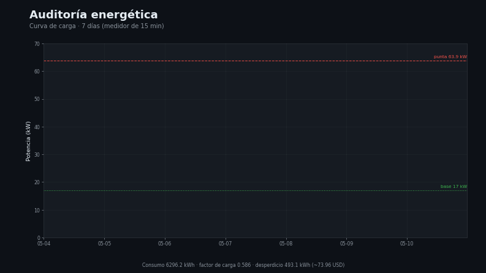

# Capa 6 — Eficiencia energética

[`lazarolpro/auditoria-energetica`](https://github.com/lazarolpro/auditoria-energetica) · parte del [portafolio de 9 capacidades](https://github.com/lazarolpro/portafolio)

**Capacidad demostrada:** convertir la curva de carga de un medidor en KPIs
accionables y en un ahorro estimado en dinero.

> © 2026 Ronny L. Díaz López. **Todos los derechos reservados.** El código fuente,
> los datos de detalle y los informes completos son propiedad del autor y no se
> publican. Prohibida su venta o uso comercial sin autorización escrita. Ver
> [`LICENSE`](LICENSE).

## Problema real

El consumo se paga todos los meses, pero el desperdicio es invisible: equipos que
siguen encendidos fuera de horario, cargas ociosas de noche, factor de carga bajo.
Sin cuantificarlo en dinero, no hay decisión.

## Qué hace

- Analiza la curva de carga de 15 min de un medidor (7 días).
- Calcula consumo, demanda punta, carga base, factor de carga y consumo fuera de
  horario.
- Estima el **desperdicio** y lo traduce a coste, con recomendaciones.

## Demo visual

La animación recorre la curva de carga y señala la carga base y la punta. Video
completo: [`assets/auditoria_demo.mp4`](assets/auditoria_demo.mp4).

## Evidencia que produce

- `assets/auditoria_demo.mp4`, `auditoria_demo.gif`, `auditoria_demo_poster.png` —
  demo visual animado (con miniatura).
- [`assets/muestra_auditoria.pdf`](assets/muestra_auditoria.pdf) — muestra resumida
  del informe de auditoría (con marca de agua).
- [`load_profile.svg`](load_profile.svg) — perfil de carga (gráfico).
- [`data/meter_15min.csv`](data/meter_15min.csv) — datos de entrada del medidor.

## Alcance de este repositorio

Este repositorio es una **vitrina del resultado**: muestra los KPIs, el gráfico de
carga y el ahorro estimado. El **código fuente** y los **informes completos** son
propiedad del autor y se mantienen fuera del repositorio público.

## Stack

Python 3 (solo biblioteca estándar: `csv`, `datetime`, `statistics`). Sin
dependencias. *(El código no se publica; ver `LICENSE`.)*

## Por qué le importa a la empresa

Responde a **proyectos de eficiencia energética**: identificar el desperdicio,
cuantificarlo en dinero y proponer acciones medibles.

**En mantenimiento:** detectar consumo anómalo y justificar la reparación o el
recambio.
